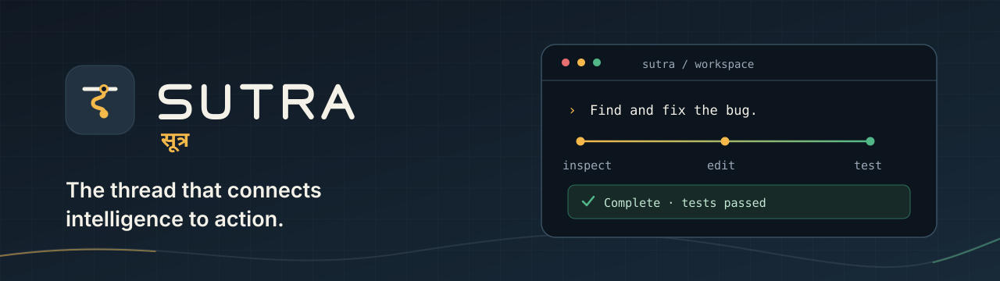

<p align="center">
  
</p>

<p align="center">
  <strong>An open-source AI coding agent for your terminal.</strong><br>
  It reads your code, makes the change, runs your tests, and tells you exactly what it did.
</p>

<p align="center">
  <a href="LICENSE"></a>
  
  
  
</p>

<p align="center">
  <a href="#quick-start">Quick start</a> ·
  <a href="#using-sutra">Using Sutra</a> ·
  <a href="#staying-in-control">Permissions</a> ·
  <a href="#cost-and-budgets">Cost</a> ·
  <a href="#how-it-works">How it works</a> ·
  <a href="docs/">Docs</a>
</p>

---

**Sutra** (सूत्र, Sanskrit for *thread* or *guiding principle*) is a coding agent that works in your terminal. You describe a task. Sutra explores the repository, plans, edits files, runs your tests, and keeps going until the task is done, or until it needs you.

Three ideas shape it:

- **You can see everything.** Every file read, edit, command and test run appears on screen as it happens, and is saved to a local history you can resume.
- **You stay in charge.** Sutra itself decides what may run without asking, so a clever prompt or a malicious file can't talk it into skipping your approval.
- **You know what it costs.** Token usage and estimated spend are tracked per request, and a budget can pause the agent before it overspends.

Sutra runs on [DeepSeek](https://api-docs.deepseek.com/) today. The agent talks to models through a small provider interface, so other providers can be added without touching the core.

## See it work

A real bug in the bundled example (`examples/session-expiry`): a timestamp in seconds is compared with one in milliseconds, so every session looks expired.

```
› The session tests fail. Find and fix the bug.

Sutra  /  turn 1
│ Inspecting repository.
│
├─ ✓ read_file       src/session.js                              16 lines
├─ ✓ grep_search     expiresAt                                   8 matches
├─ ✓ run_tests       npm test                                exit 1 · 0.3s
│                    2 of 4 failed
│
│ Found an issue in token expiration handling: expiresAt is in seconds
│ but now is milliseconds.
│
╰─ ● edit_file       src/session.js                         waiting on you
╭────────────────────────────────────────────────────────────────────────╮
│  APPROVE   edit_file  src/session.js                             +1 −1 │
│ Reason   modify files                                                  │
│ ╭────────────────────────────────────────────────────────────────────╮ │
│ │ @@ -3,7 +3,7 @@                                                    │ │
│ │   6      −    return session.expiresAt < now;                      │ │
│ │       6  +    return session.expiresAt * 1000 <= now;              │ │
│ ╰────────────────────────────────────────────────────────────────────╯ │
│ Apply this action?   y  yes    a  allow edits this session    N  no    │
╰────────────────────────────────────────────────────────────────────────╯

├─ ✓ edit_file       src/session.js                     +1 −1 · approved
├─ ✓ run_tests       npm test                                exit 0 · 0.3s
│                    4 of 4 passed
│
│ Fixed isExpired in src/session.js. All 4 tests pass.
│
●
──────────────────────────────────────────────────────────────────────────
Sutra  /  Complete  ·  5 iterations · 5 tool calls · 9s

╭────────────────╮ ╭────────────────╮ ╭────────────────╮ ╭────────────────╮
│ FILES CHANGED  │ │ TESTS          │ │ TOKENS         │ │ ESTIMATED COST │
│ 1              │ │ ✓ passed       │ │ 7,500 in       │ │ $0.0016        │
│ src/session.js │ │ 4 of 4 passed  │ │ 600 out · 67%… │ │ session $0.00… │
╰────────────────╯ ╰────────────────╯ ╰────────────────╯ ╰────────────────╯
```

<sub>The layout is exactly what Sutra draws; the numbers are illustrative. In a real run, every line comes from an actual event: test counts are read from your test runner's output, and tokens and cost come from the provider's reported usage.</sub>

How to read it: each turn is one **thread**. Sutra's explanations sit on the `│` line, and every tool call hangs off it as a row showing the outcome (`✓` ok, `✗` error, `⊘` denied, `–` cancelled), the tool, its target, and a short result on the right. The thread ends in `●`, followed by a summary of what changed.

## Quick start

**1. Install.** You need Node.js 22.13 or newer, on macOS or Linux. `ripgrep` is optional and makes search faster.

```bash
git clone <repository-url> sutra
cd sutra
npm install
npm run build
npm link        # puts the `sutra` command on your PATH
```

**2. Connect a model.** Get an API key from the [DeepSeek platform](https://platform.deepseek.com/api_keys), then run:

```bash
sutra init
```

The setup walks you through choosing a provider and model and stores your key safely (more below). It also checks that the API is reachable and, only if you say yes, sends one tiny test request.

Prefer environment variables? Set these instead:

```bash
export DEEPSEEK_API_KEY=sk-...
export DEEPSEEK_MODEL=deepseek-flash      # or deepseek-v4-pro
```

**3. Try it on the example.**

```bash
cd examples/session-expiry
npm test                                   # 2 of 4 tests fail
sutra "The session tests fail. Find and fix the bug."
```

Approve the edit when Sutra asks, watch it re-run the tests, and type `/cost` to see what the session cost. Exit with `/exit`, then come back to the same conversation:

```bash
sutra --resume "What did you change?"
```

> [!NOTE]
> Your API key is stored in `~/.sutra/credentials.json` with owner-only permissions (mode 600). It is never printed, never written inside a repository, and stripped from the environment of every command Sutra runs.

## Using Sutra

### Starting a session

| Command | What it does |
| --- | --- |
| `sutra` | Start an interactive session in the current directory |
| `sutra "explain this repository"` | Start a session with a first task |
| `sutra --resume` | Continue the most recent session in this directory |
| `sutra --session 3f2a9c1e` | Resume a specific session (an ID prefix is enough) |
| `sutra -p "summarise src/auth"` | Run once without the UI: the answer goes to stdout, activity to stderr |
| `sutra -p --json "…"` | Same, but print every runtime event as a JSON line |
| `sutra --readonly` | Look, don't touch: no edits, no commands |
| `sutra --model deepseek-v4-pro` | Pick a model for this session |
| `sutra --no-color` | Plain output (`NO_COLOR` also works) |
| `sutra --lang hi` | Hindi interface text |

### Inside a session

Type `/` to open the command palette. ↑↓ selects a command, Tab completes it, and Enter runs it.

| Command | |
| --- | --- |
| `/help` | Commands and keyboard shortcuts |
| `/status` | Model, workspace, permission profile, context size, instruction files |
| `/cost` | Tokens, requests, tool calls, latency and estimated spend |
| `/budget 0.50` | Set a spend limit for this session (`/budget off` removes it) |
| `/plan` | Sutra's current plan for a multi-step task |
| `/model [id]` | Show or switch the model |
| `/permissions [profile]` | Show or switch the permission profile |
| `/compact` | Summarise older context now, to save tokens |
| `/sessions` | Recent sessions in this directory |
| `/clear` | Start fresh (the old session stays saved) |
| `/exit` | Quit |

**Keys.** `Enter` sends. `⇧ Enter` adds a new line. `Esc` stops the current turn: running commands are killed and nothing is left half-recorded. `Ctrl+C` twice exits. `↑` `↓` browse your previous prompts. You can type while Sutra is working; your message is queued and sent when the turn finishes.

## Staying in control

Sutra has three permission profiles. The default, **Confirm**, shows you every change before it happens.

| Profile | Reading files | Editing files | Running commands |
| --- | --- | --- | --- |
| **Inspect** (`--readonly`) | Inside the workspace | Never | Never |
| **Confirm** (default) | Automatic | You approve each change, with a diff | You approve each command |
| **Flow** (`--profile flow`) | Automatic | Automatic inside the workspace | Automatic for routine checks like `npm test` or `git status`; anything else asks |

**Every profile still asks before:**

- deleting files
- touching anything outside the workspace, or sensitive files (`.env`, keys, credentials)
- destructive commands: `rm`, `git reset --hard`, `git push`, …
- network access: `curl`, package installs, `git fetch`, …
- `sudo`

Writes into `.git/`, and into any paths you mark as protected, are refused outright.

At an approval prompt, `y` allows the action once. `a` allows that kind of action for the rest of the session; it's only offered for routine actions, never for destructive ones. `n` or `Enter` declines. A declined action is reported back to the model, which has to find another way or ask you.

Because these rules live in Sutra's own code, nothing the model reads can change them: not a README, not a code comment, not a crafted test output. Repository instruction files can describe conventions, but they can't loosen permissions.

> [!IMPORTANT]
> Sutra is an **approval gate, not a sandbox**. Once you approve a command, it runs with your normal user permissions, and a "test" script can do anything a script can do. Read commands before you approve them. [docs/security.md](docs/security.md) explains the threat model and its limits.

## Cost and budgets

Sutra records every request's input, cached, output and reasoning tokens, plus latency and tool time. `/cost` shows the totals:

```
Session usage

Input tokens      48,210
  cached (hit)    30,114
Output tokens     12,840
  reasoning        4,002
API requests      19
Tool calls        43

Estimated cost    $0.0213
```

<sub>Example output.</sub>

- **Real prices, clearly dated.** Costs are estimated from DeepSeek's published per-token prices, including cache-hit pricing and off-peak rates. Every report says the date its prices are from, and you can override them in your config.
- **Budgets.** Set a limit with `/budget 1.00` or in your config. Sutra warns you at 80% of the limit, and pauses before the next request once it's reached.
- **Built to be cheap.** The system prompt stays the same for a whole session, so DeepSeek's prompt cache keeps working. Context is capped at 200K tokens by default and compacted when it gets large.

## Sessions and memory

Everything is saved locally in SQLite (`~/.sutra/sutra.db`): messages, tool calls and their results, plans, token usage and checkpoints.

- `sutra --resume` picks up exactly where you left off. If the last session was interrupted in the middle of a tool call, Sutra records what happened, so the conversation stays consistent.
- In long sessions, older context is **compacted** into a structured summary: your requirements, decisions, files changed, open errors and next steps. Sutra tells you when this happens, and you can trigger it yourself with `/compact`. The full history stays on disk.

### Project instructions

Put an `AGENTS.md` in your repository, or `.sutra/AGENTS.md`, to tell Sutra how your project works: test commands, conventions, directories to leave alone. Run `sutra init` to create a template. Sutra also reads `~/.sutra/AGENTS.md` for your personal preferences across all projects. These files are treated as guidance; they can never override the permission rules.

## How it works

```
 you ─► context ─► model ─► tool calls ─► permission check ─► run ─► results ─┐
            ▲                                                                  │
            └──────────────────────── next step ◄──────────────────────────────┘
                                         │
                             done, stopped, or over budget
```

- **One loop, many steps.** Each turn repeats *think → act → observe* until the model is done, you cancel it, or a limit is reached. Every turn ends in an explicit state: completed, failed, cancelled, or over budget.
- **Fast where it's safe.** Several read-only tools (reads, searches) can run at once. Edits and commands run one at a time, in order.
- **Nothing gets lost.** Every tool call gets exactly one recorded result, including failures, denials and cancellations. Repeated identical calls are detected and stopped.
- **Careful edits.** Writes are atomic and checked after writing. Sutra won't overwrite a file it hasn't read, or one that changed since it last looked.

**Built-in tools:** `read_file`, `list_directory`, `glob_files`, `search_files`, `grep_search`, `write_file`, `edit_file`, `apply_patch`, `execute_command`, `run_tests`, `git_status`, `git_diff`, `update_plan`.

More detail is in [docs/architecture.md](docs/architecture.md).

## Configuration

Settings live in `~/.sutra/config.json`. Each repository can add a limited `.sutra/config.json` (model, test command, extra protected paths). A small example:

```json
{
  "model": "deepseek-flash",
  "permissions": { "profile": "confirm", "protectedPaths": ["vendor/"] },
  "budget": { "maxSessionCostUsd": 1.0 },
  "tools": { "testCommand": "npm test" }
}
```

Every option, and the order in which settings override each other, is listed in [docs/configuration.md](docs/configuration.md).

## Status

Sutra is an **early preview (v0.1)**. The core is complete and well tested: the agent loop, all tools, permissions, sessions, compaction, cost tracking and the terminal UI. There are 100 automated tests, including an end-to-end run that fixes the example bug through the real CLI and the real test suite.

What to know before relying on it:

- **One provider so far.** Only DeepSeek is supported. OpenAI-compatible and local (Ollama) providers are next.
- **Live API checks are opt-in.** The automated tests talk to a local server that speaks DeepSeek's exact streaming protocol. To check against the real API, run `DEEPSEEK_API_KEY=… npm run test:smoke`; it costs a fraction of a cent.
- **No OS sandbox.** Approvals are enforced by Sutra, not by the operating system.
- **macOS first.** Developed on macOS. Linux should work but isn't covered by CI yet. Windows isn't supported yet.
- **Costs are estimates.** They use published prices; DeepSeek's holiday discounts aren't modelled.

## Roadmap

- [x] Multi-step agent loop with parallel reads, loop detection and budgets
- [x] DeepSeek provider: streaming, thinking mode, tool calls, retries, cancellation
- [x] Safe editing with diff approval
- [x] Permission profiles and command risk checks
- [x] Saved sessions, resume and context compaction
- [x] Cost tracking and spend limits
- [x] Terminal UI: thread view, command palette, light and dark themes
- [ ] OpenAI-compatible and Ollama providers
- [ ] Linux CI and Windows support
- [ ] Sub-agents for exploring, reviewing and testing
- [ ] MCP tool integration
- [ ] Optional OS-level sandboxing

## Contributing

Contributions are welcome. To get set up:

```bash
npm install
npm run typecheck
npm test             # no network or API key needed
npm run dev -- "…"   # run Sutra from source
```

Please read [CONTRIBUTING.md](CONTRIBUTING.md) first. The one rule that matters most: Sutra never fakes anything. What the UI shows must come from something that really happened, and what a tool reports must be what it really did.

Found a security problem? Please report it privately rather than in a public issue (see [docs/security.md](docs/security.md)).

## License

Sutra is released under the [Apache License 2.0](LICENSE). Like MIT it's permissive, and it also includes an explicit patent grant from contributors. See [NOTICE](NOTICE) for third-party attributions.

<p align="center"><sub>सूत्र · the thread that connects intelligence to action</sub></p>
